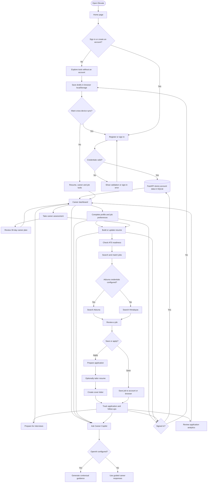

# Elevate end-to-end user flow

Password recovery branches from the sign-in page: request a reset email, open its single-use link, set a new password, and return to sign-in. Email delivery requires SMTP configuration.
